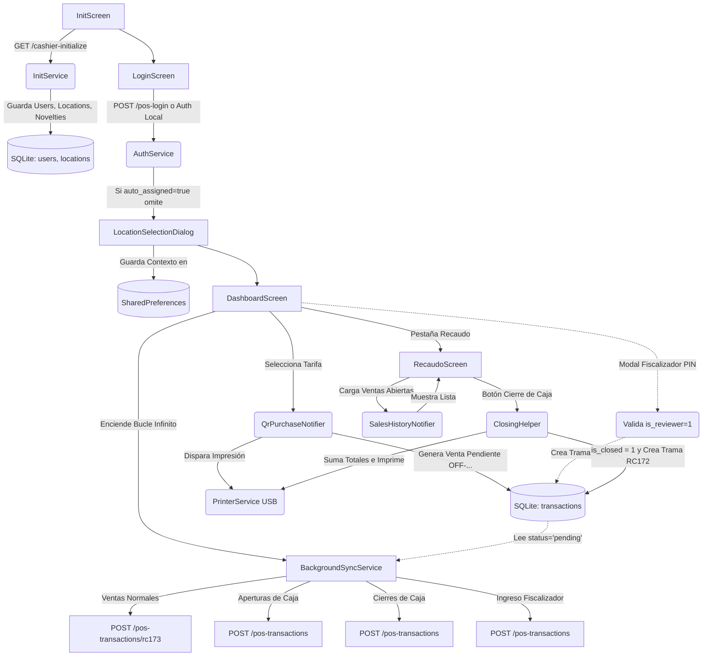

# Arquitectura, Flujos y Lógica Core del Sistema POS (Offline-First)

Este documento es la **fuente de la verdad** técnica del proyecto. Si un desarrollador o un agente de IA necesita entender cómo funciona la aplicación para corregir un bug o añadir una funcionalidad, todo el conocimiento estructural está aquí.

## 1. Topología y Diagrama de Árbol (Flujo General)

A continuación, un diagrama que muestra la ruta de datos desde que el usuario abre la app hasta que la data llega al servidor en segundo plano:



---

## 2. Árbol de Directorios Core (`lib/`)

```text
lib/
├── core/
│   ├── database/        -> DatabaseHelper.dart (Esquema SQLite y Migraciones)
│   ├── storage/         -> LocalStorageRepository.dart (SharedPreferences)
│   ├── network/         -> DioClient.dart (Configuración de Headers y Token)
│   ├── services/        -> KioskService.dart (Modo kiosco: Lock Task / Device Owner)
│   ├── widgets/         -> KioskLogoButton.dart (Acceso admin: 3 taps + PIN)
│   └── utils/           -> Utilidades como DeviceUtils (MAC address)
├── features/
│   ├── auth/            -> Pantallas de Login y Selección de Sucursal, AuthService.
│   ├── sales/           -> Dashboard, Recaudo, Ventas, ClosingHelper.
│   ├── sync/            -> InitScreen, InitService, BackgroundSyncService.
│   └── printer/         -> PrinterService (Conexión hardware USB Host), TicketWidget.
└── main.dart            -> Punto de entrada, Riverpod, Rutas y activación del kiosco.

android/app/src/main/
├── kotlin/.../MainActivity.kt            -> Canales nativos: impresión USB y kiosco (co.Juana.kiosk)
├── kotlin/.../KioskDeviceAdminReceiver.kt -> Receiver para aprovisionar como Device Owner
└── res/xml/device_admin.xml              -> Políticas de administración del dispositivo
```

---

## 3. Filosofía Base (Offline-First)
La aplicación está diseñada para funcionar sin internet por días enteros sin bloquear la operación.
- **Regla de oro:** Toda transacción (Venta, Cierre, Apertura, Logs) **siempre nace en SQLite** con estado `pending`.
- **UI Reactiva:** La interfaz gráfica (Flutter) reacciona a los datos en SQLite, NUNCA a respuestas HTTP de las ventas.
- **Sincronización:** El `BackgroundSyncService` corre perpetuamente escaneando la base de datos y enviando los datos por debajo de la mesa cuando hay red disponible.

---

## 4. Esquema de Base de Datos Crítica (SQLite)

La base de datos maneja tablas esenciales para el funcionamiento offline:
- `users`: Copia local de los cajeros autorizados. Campos clave: `id`, `email`, `password_hash` (para login sin red), `is_reviewer`, `reviewer_code`.
- `sessions`: Controla el día de operación. Campos clave: `id`, `branch_id`, `status` ('open' o 'closed').
- `transactions`: El corazón de la app. Guarda todas las tramas.
  - Campos clave: `local_id`, `session_id`, `cashier_id`, `product_id`, `status` ('pending' o 'synced'), `is_closed` (0 o 1).

---

## 5. Manejo de Sesiones Diarias (`SessionService`)

**La Sesión le pertenece a la Tablet y al Día Calendario, NO al Cajero.**
1. **Apertura:** Si a las 6 AM un cajero inicia sesión, se crea la Sesión Global #1.
2. **Múltiples Cajeros:** Si a las 2 PM el primer cajero se va, y entra otro cajero, **el segundo cajero hereda la misma Sesión Global #1**. Sus ventas no se mezclan porque se separan usando la columna `cashier_id` en la tabla `transactions`.
3. **Cambio de Día (Late Close):** Si un cajero entra al día siguiente, el sistema detecta que la sesión activa es de ayer, la fuerza a estado `late_closed` y abre una nueva.

---

## 6. Lógica de Flujos Clave

### A. Inicialización y Auto-Asignación (`InitService`)
Al arrancar, descarga catálogos. Si la API manda un objeto `pos_assign_pos_location`, la app lo guarda inmediatamente en memoria y salta de forma transparente la pantalla de selección de punto de venta post-login. Envía la dirección MAC (`ime`) en la solicitud para identificarse.

### B. El Proceso de Venta (`QrPurchaseNotifier`)
Al tocar una tarifa, se genera un ID local, se encripta un string alfanumérico aleatorio (QR local) y se inserta en `transactions`. El estado nace en `pending`. Esto dispara el ticket de inmediato por el puerto USB.

### C. Bloqueo de Recaudo e Ingreso de Fiscalizador
Si se toca la pestaña "Recaudo", se pide un PIN. Si hace match en SQLite (`is_reviewer = 1`), se inserta en `transactions` una trama invisible (`product_id = 'INGRESO_FISCALIZADOR'`, `is_closed = 1`). Esto permite la entrada a la vista y deja la huella de auditoría (Trama RC171).

### D. Historial y Filtros (`SalesHistoryNotifier`)
La pantalla de Recaudo lee `transactions` filtrando al cajero y sesión actual. **Oculta intencionalmente** los eventos del sistema usando:
`product_id NOT IN ('CIERRE DE CAJA', 'APERTURA DE CAJA', 'PMR', 'INGRESO_FISCALIZADOR')`.
Si modificas la app creando un nuevo tipo de transacción no monetaria, **debes añadirla a este filtro**.

### E. Cierre de Caja (`ClosingHelper`)
Suma el total de `amount` de las ventas abiertas (`is_closed = 0`) del cajero.
1. Actualiza esas ventas a `is_closed = 1`.
2. Imprime el arqueo.
3. Inserta un nuevo registro `CIERRE DE CAJA` en `transactions`.
**Nota:** NO cierra la Sesión Global, permitiendo al siguiente turno operar.

---

## 7. Diccionario de Tramas (BackgroundSyncService)
El motor de sincronización traduce los registros de SQLite a JSON POST endpoints:

| Trama | Origen en SQLite (`product_id`) | Destino API | Propósito |
| :--- | :--- | :--- | :--- |
| **RC173** | Cualquier Tarifa/Pasaje | `/pos-transactions/rc173` | Enviar bloques de ventas de pasajes. |
| **RC174** | `'APERTURA DE CAJA'` | `/pos-transactions` | Avisar inicio de operaciones de un cajero. |
| **RC172** | `'CIERRE DE CAJA'` | `/pos-transactions` | Cuadre, suma de dinero físico e impresión de fin de turno. |
| **RC171** | `'INGRESO_FISCALIZADOR'`| `/pos-transactions` | Log de auditoría silente. Indica que el supervisor revisó la caja. |

Si debes crear un nuevo evento hacia el servidor (Ej: un "Retiro de Efectivo"), debes asignarle un nuevo `product_id` en SQLite, crear su Trama RC17X en el `BackgroundSyncService` y asegurarte de ocultarlo en los listados visuales si no representa una venta directa.

---

## 8. Modo Kiosco Real (Device Owner + Lock Task Mode)

La tablet debe ser inviolable para el taquillero: no puede salir de la app, ni revelar las barras del sistema, ni modificar el dispositivo.

### Las dos capas de bloqueo

| Capa | Mecanismo | Qué hace |
| :--- | :--- | :--- |
| **Visual** | `SystemUiMode.immersiveSticky` (main.dart) + `category.HOME` (Manifest) | Oculta las barras y hace la app launcher. **Insuficiente sola:** un swipe en los bordes revela las barras. |
| **Real** | **Lock Task Mode** con la app como **Device Owner** | Bloquea de verdad la barra de estado, la de navegación, los gestos, Home y Recientes. Sin escape posible. |

### Componentes

- **`KioskDeviceAdminReceiver.kt`** (+ `device_admin.xml` + receiver en Manifest): habilita el aprovisionamiento como Device Owner.
- **Canal nativo `co.Juana.kiosk`** (MainActivity.kt): `isDeviceOwner`, `isInKioskMode`, `startKiosk`, `stopKiosk`, `clearDeviceOwner`.
- **`KioskService`** (Dart, `core/services/`): wrapper del canal. **Degrada de forma segura**: si la tablet no está aprovisionada, todos los métodos son no-op y retornan `false` (el desarrollo en emulador no se ve afectado).
- **`main.dart`**: llama `KioskService.start()` tras el primer frame. La app entra sola al kiosco en cada arranque.
- **Menú admin** (`KioskLogoButton`: 3 taps en el logo + PIN `9999`, en LoginScreen): *Ajustes del Sistema* (sale del kiosco primero — el lock task bloquea abrir Settings), *Exportar Tramas*, *Activar Modo Kiosco* y *Liberar Dispositivo*.

### Aprovisionamiento (una vez por tablet)

La tablet **no debe tener cuentas Google añadidas**. Con ADB (USB o inalámbrico):

```
adb shell dpm set-device-owner co.Juana.red_recarga_pos/.KioskDeviceAdminReceiver
```

Alternativa sin PC: **aprovisionamiento por QR** en tablet recién reseteada (6 taps en la pantalla de bienvenida → escanear QR con la URL del APK y el checksum de firma). El estado de Device Owner sobrevive a actualizaciones y reinicios.

### Procedimientos operativos (soporte técnico)

| Necesidad | Procedimiento |
| :--- | :--- |
| **Actualizar versión** | NO se quita nada. PIN → salir del kiosco → instalar APK (o `adb install -r` directo, ADB no está bloqueado por el kiosco). |
| **Mantenimiento / Ajustes** | PIN → "Ajustes del Sistema". Al terminar: PIN → "Activar Modo Kiosco". |
| **Desinstalar o bajar versión** | PIN → "Liberar Dispositivo" (la app deja de ser Device Owner) → desinstalar → instalar → re-aprovisionar por ADB. |
| **Tablet bloqueada sin PIN** | ADB inalámbrico si quedó activo; última instancia: factory reset por recovery (Vol + Power) y re-enrolar. |

### ⚠️ Conflicto conocido: permiso USB de la impresora

El lock task **suprime los diálogos del sistema**, incluido el de permiso USB (`UsbManager.requestPermission`) y el de asociación al conectar la impresora. Sin ese permiso la impresión falla en silencio.

**Solución obligatoria al enrolar cada tablet:** estando FUERA del kiosco, desconectar y reconectar la impresora Epson, y en el diálogo "¿Abrir Juana cuando se conecte este dispositivo USB?" marcar **"Usar siempre"**. Con esa asociación, Android otorga el permiso automáticamente sin diálogo en cada conexión y arranque, incluso dentro del kiosco. (El match del dispositivo está en `res/xml/device_filter.xml`, VID 1208 = Epson.)

### Reglas para no romper el kiosco

1. **No desactivar la Depuración USB/inalámbrica** en las tablets: es la puerta de mantenimiento.
2. El PIN admin está hardcodeado en `KioskLogoButton` (`'9999'`): es la única llave en campo. *Mejora pendiente: moverlo a configuración remota (cashier-initialize).*
3. Si agregas un flujo que necesite abrir una app o diálogo externo (cámara, archivos, otra activity), recuerda que **el lock task lo bloqueará**: debe pasar por `KioskService.stop()` primero o agregarse el paquete a `setLockTaskPackages`.
4. *Mejora pendiente: timeout defensivo en `printViaUsbDirect` para que una impresión sin permiso USB responda error en vez de quedar colgada.*
