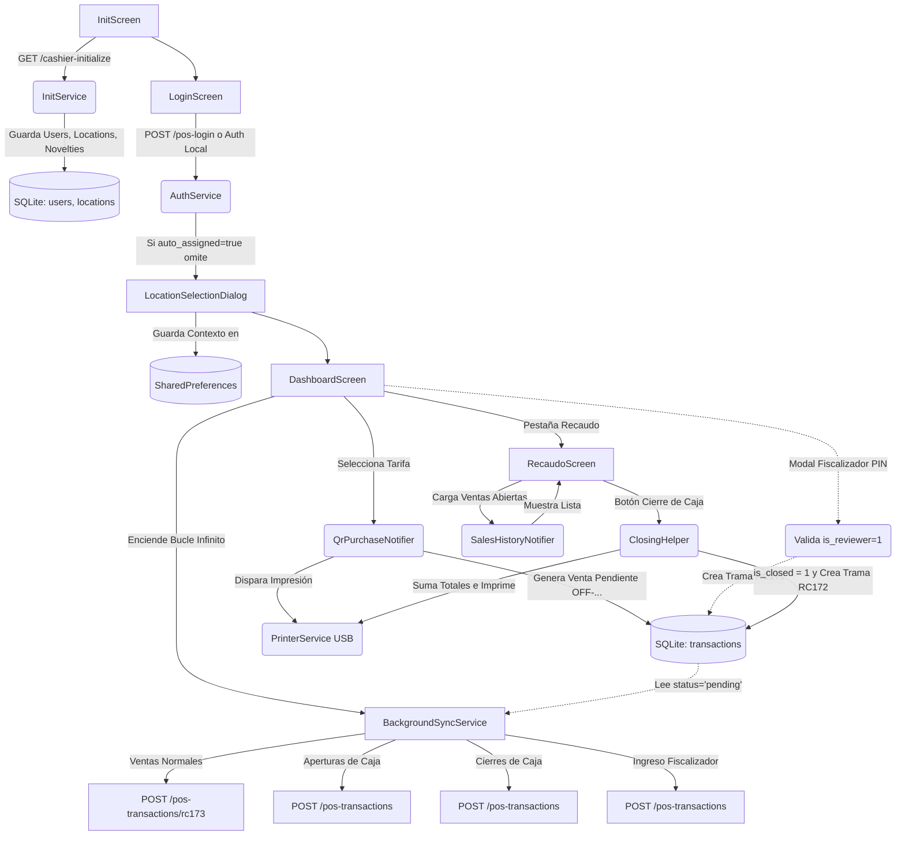

# Arquitectura, Flujos y Lógica Core del Sistema POS (Offline-First)

Este documento es la **fuente de la verdad** técnica del proyecto. Si un desarrollador o un agente de IA necesita entender cómo funciona la aplicación para corregir un bug o añadir una funcionalidad, todo el conocimiento estructural está aquí.

## 1. Topología y Diagrama de Árbol (Flujo General)

A continuación, un diagrama que muestra la ruta de datos desde que el usuario abre la app hasta que la data llega al servidor en segundo plano:



---

## 2. Árbol de Directorios Core (`lib/`)

```text
lib/
├── core/
│   ├── database/        -> DatabaseHelper.dart (Esquema SQLite y Migraciones)
│   ├── storage/         -> LocalStorageRepository.dart (SharedPreferences)
│   ├── network/         -> DioClient.dart (Configuración de Headers y Token)
│   └── utils/           -> Utilidades como DeviceUtils (MAC address)
├── features/
│   ├── auth/            -> Pantallas de Login y Selección de Sucursal, AuthService.
│   ├── sales/           -> Dashboard, Recaudo, Ventas, ClosingHelper.
│   ├── sync/            -> InitScreen, InitService, BackgroundSyncService.
│   └── printer/         -> PrinterService (Conexión hardware USB Host), TicketWidget.
└── main.dart            -> Punto de entrada, inicialización de Riverpod y Rutas.
```

---

## 3. Filosofía Base (Offline-First)
La aplicación está diseñada para funcionar sin internet por días enteros sin bloquear la operación.
- **Regla de oro:** Toda transacción (Venta, Cierre, Apertura, Logs) **siempre nace en SQLite** con estado `pending`.
- **UI Reactiva:** La interfaz gráfica (Flutter) reacciona a los datos en SQLite, NUNCA a respuestas HTTP de las ventas.
- **Sincronización:** El `BackgroundSyncService` corre perpetuamente escaneando la base de datos y enviando los datos por debajo de la mesa cuando hay red disponible.

---

## 4. Esquema de Base de Datos Crítica (SQLite)

La base de datos maneja tablas esenciales para el funcionamiento offline:
- `users`: Copia local de los cajeros autorizados. Campos clave: `id`, `email`, `password_hash` (para login sin red), `is_reviewer`, `reviewer_code`.
- `sessions`: Controla el día de operación. Campos clave: `id`, `branch_id`, `status` ('open' o 'closed').
- `transactions`: El corazón de la app. Guarda todas las tramas.
  - Campos clave: `local_id`, `session_id`, `cashier_id`, `product_id`, `status` ('pending' o 'synced'), `is_closed` (0 o 1).

---

## 5. Manejo de Sesiones Diarias (`SessionService`)

**La Sesión le pertenece a la Tablet y al Día Calendario, NO al Cajero.**
1. **Apertura:** Si a las 6 AM un cajero inicia sesión, se crea la Sesión Global #1.
2. **Múltiples Cajeros:** Si a las 2 PM el primer cajero se va, y entra otro cajero, **el segundo cajero hereda la misma Sesión Global #1**. Sus ventas no se mezclan porque se separan usando la columna `cashier_id` en la tabla `transactions`.
3. **Cambio de Día (Late Close):** Si un cajero entra al día siguiente, el sistema detecta que la sesión activa es de ayer, la fuerza a estado `late_closed` y abre una nueva.

---

## 6. Lógica de Flujos Clave

### A. Inicialización y Auto-Asignación (`InitService`)
Al arrancar, descarga catálogos. Si la API manda un objeto `pos_assign_pos_location`, la app lo guarda inmediatamente en memoria y salta de forma transparente la pantalla de selección de punto de venta post-login. Envía la dirección MAC (`ime`) en la solicitud para identificarse.

### B. El Proceso de Venta (`QrPurchaseNotifier`)
Al tocar una tarifa, se genera un ID local, se encripta un string alfanumérico aleatorio (QR local) y se inserta en `transactions`. El estado nace en `pending`. Esto dispara el ticket de inmediato por el puerto USB.

### C. Bloqueo de Recaudo e Ingreso de Fiscalizador
Si se toca la pestaña "Recaudo", se pide un PIN. Si hace match en SQLite (`is_reviewer = 1`), se inserta en `transactions` una trama invisible (`product_id = 'INGRESO_FISCALIZADOR'`, `is_closed = 1`). Esto permite la entrada a la vista y deja la huella de auditoría (Trama RC171).

### D. Historial y Filtros (`SalesHistoryNotifier`)
La pantalla de Recaudo lee `transactions` filtrando al cajero y sesión actual. **Oculta intencionalmente** los eventos del sistema usando:
`product_id NOT IN ('CIERRE DE CAJA', 'APERTURA DE CAJA', 'PMR', 'INGRESO_FISCALIZADOR')`.
Si modificas la app creando un nuevo tipo de transacción no monetaria, **debes añadirla a este filtro**.

### E. Cierre de Caja (`ClosingHelper`)
Suma el total de `amount` de las ventas abiertas (`is_closed = 0`) del cajero.
1. Actualiza esas ventas a `is_closed = 1`.
2. Imprime el arqueo.
3. Inserta un nuevo registro `CIERRE DE CAJA` en `transactions`.
**Nota:** NO cierra la Sesión Global, permitiendo al siguiente turno operar.

---

## 7. Diccionario de Tramas (BackgroundSyncService)
El motor de sincronización traduce los registros de SQLite a JSON POST endpoints:

| Trama | Origen en SQLite (`product_id`) | Destino API | Propósito |
| :--- | :--- | :--- | :--- |
| **RC173** | Cualquier Tarifa/Pasaje | `/pos-transactions/rc173` | Enviar bloques de ventas de pasajes. |
| **RC174** | `'APERTURA DE CAJA'` | `/pos-transactions` | Avisar inicio de operaciones de un cajero. |
| **RC172** | `'CIERRE DE CAJA'` | `/pos-transactions` | Cuadre, suma de dinero físico e impresión de fin de turno. |
| **RC171** | `'INGRESO_FISCALIZADOR'`| `/pos-transactions` | Log de auditoría silente. Indica que el supervisor revisó la caja. |

Si debes crear un nuevo evento hacia el servidor (Ej: un "Retiro de Efectivo"), debes asignarle un nuevo `product_id` en SQLite, crear su Trama RC17X en el `BackgroundSyncService` y asegurarte de ocultarlo en los listados visuales si no representa una venta directa.
