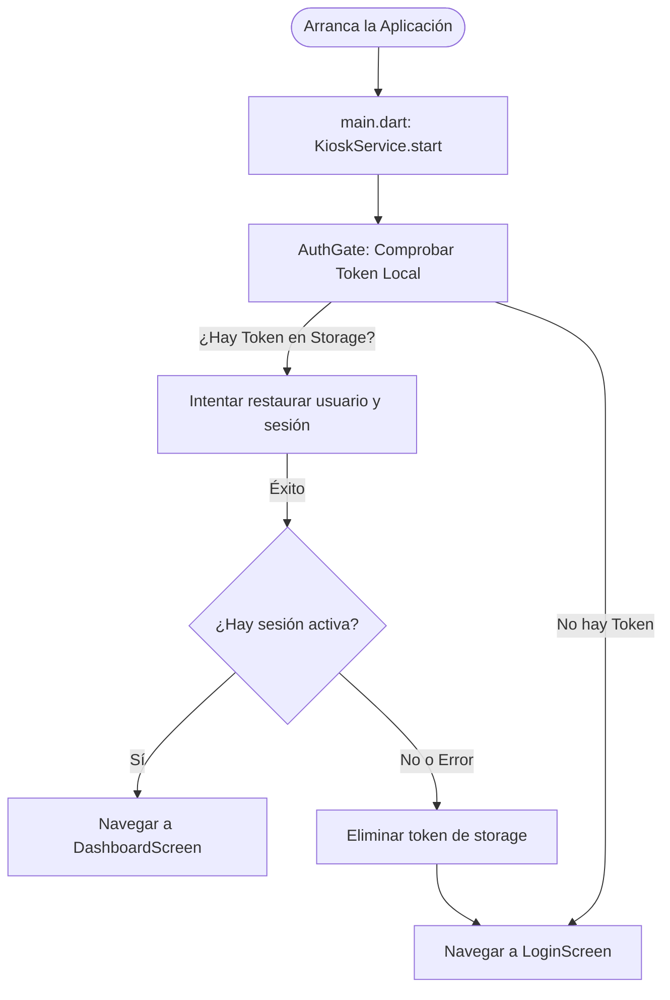
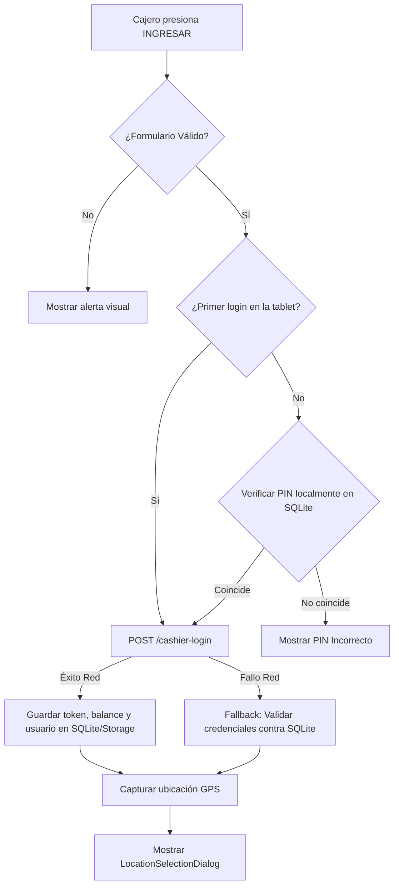
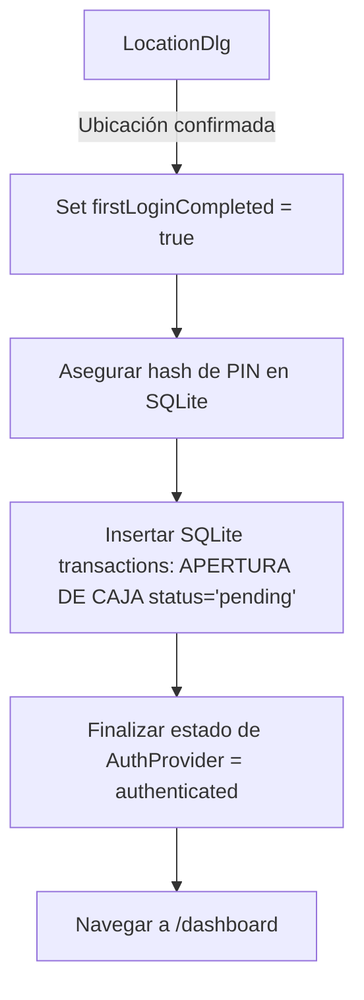
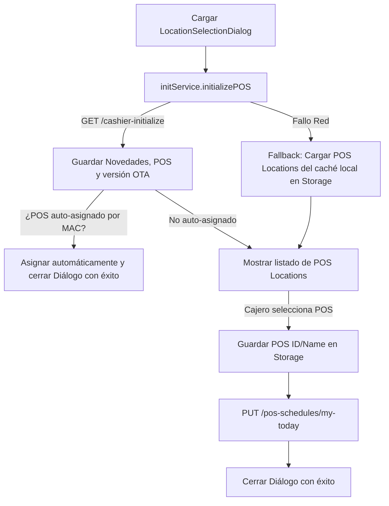
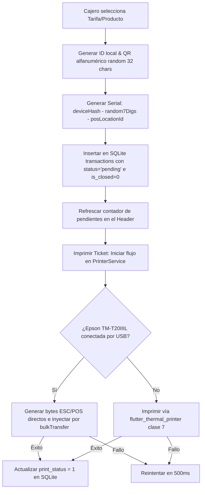
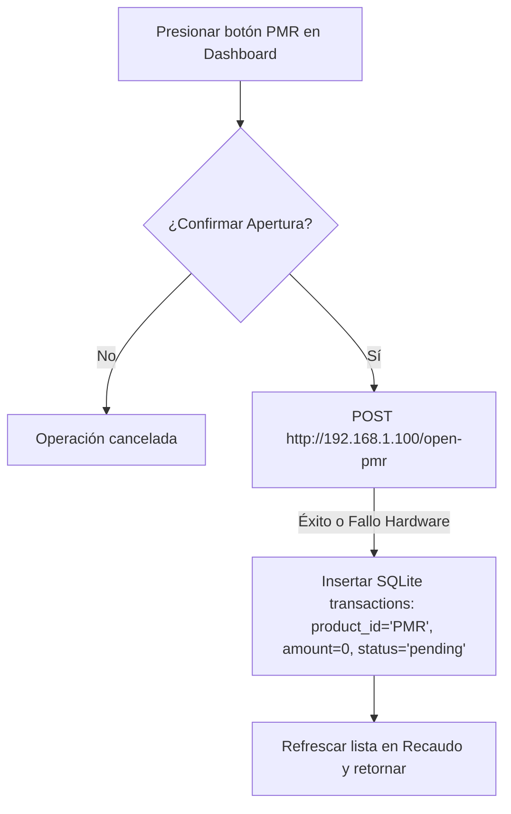
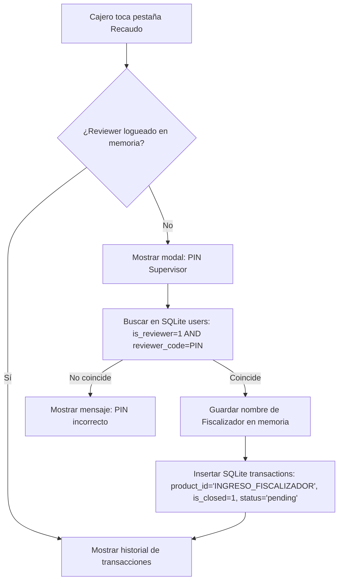
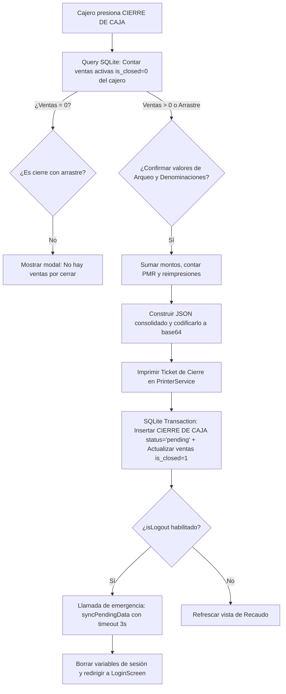
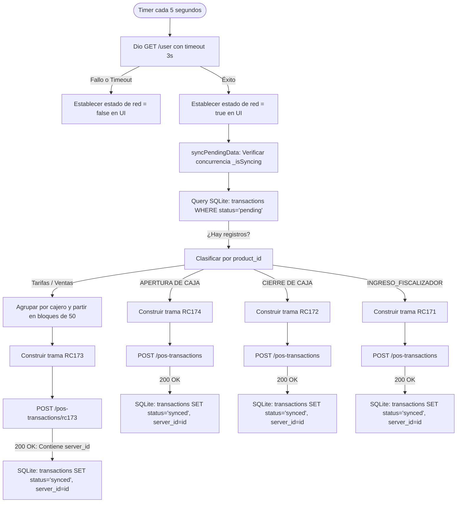
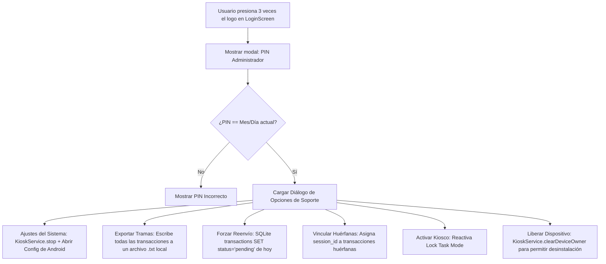

# Documentación de Flujo Completo y Arquitectura: Juana POS

Este documento constituye la **fuente de verdad definitiva** acerca del flujo lógico, funcionamiento, interacciones y sincronización del sistema POS de la Red de Recarga Juana. Describe en detalle cada paso, desde el encendido de la aplicación hasta las sincronizaciones y cierres en segundo plano.

---

## 1. Filosofía de Arquitectura (Offline-First)

La aplicación está diseñada bajo el principio **Offline-First**, lo cual significa que toda transacción y evento crítico nace en la base de datos local (SQLite) y su estado cambia de manera asíncrona mediante un servicio de segundo plano.

1. **Estado inicial `pending`**: Al realizar una Venta, una Apertura de Caja, un Cierre o un Ingreso de Fiscalizador, se escribe inmediatamente en SQLite con `status = 'pending'`.
2. **UI Reactiva a SQLite**: La interfaz de usuario no espera respuestas HTTP de la red para confirmar una venta o registrar un evento; en su lugar, se actualiza localmente y confía en el encolamiento nativo.
3. **BackgroundSyncService**: Un servicio perpetuo que corre en segundo plano y se activa cuando se detecta conexión a internet (ping exitoso). Este servicio procesa las transacciones pendientes en orden cronológico y las envía a los endpoints correspondientes en el servidor.

---

## 2. Estructura y Esquema de Datos Local (SQLite)

La base de datos SQLite se llama `JuanaPos.db` (versión activa 15) y está compuesta por las siguientes tablas principales:

### Tabla `users`
Almacena el catálogo local de cajeros autorizados para inicio de sesión sin conexión.
* **`id` (INTEGER, PK)**: ID del cajero.
* **`email` (TEXT, UNIQUE)**: Identificador de acceso (se utiliza el número de teléfono del cajero).
* **`password_hash` (TEXT)**: Hash SHA-1 de la contraseña/PIN del usuario para validar credenciales localmente (PIN assurance).
* **`name` (TEXT)**: Nombre completo del cajero.
* **`branch_id` (INTEGER)**: ID de la sucursal de pertenencia.
* **`roles` (TEXT)**: Roles del usuario (ej. `'Cajero'`).
* **`is_reviewer` (INTEGER)**: Define si es supervisor/fiscalizador (`1` o `0`).
* **`reviewer_code` (TEXT)**: PIN de fiscalizador en texto plano para auditorías de caja.

### Tabla `sessions`
Controla el periodo de operaciones diarias asociado a la tablet y sucursal.
* **`id` (INTEGER, PK, AUTOINCREMENT)**: ID autoincremental de la sesión.
* **`branch_id` (INTEGER)**: ID de la sucursal activa.
* **`opened_at` (TEXT)**: Timestamp ISO 8601 de la apertura.
* **`closed_at` (TEXT)**: Timestamp ISO 8601 del cierre.
* **`status` (TEXT)**: Estado de la sesión (`'open'`, `'closed'`, `'late_closed'`, o `'synced_closed'`).
* **`is_late` (INTEGER)**: `1` si la sesión fue cerrada automáticamente por cambio de día, `0` en caso contrario.

### Tabla `transactions`
El core del sistema, registra todas las tramas transaccionales y del sistema.
* **`local_id` (INTEGER, PK, AUTOINCREMENT)**: Identificador único autoincremental local.
* **`id` (TEXT)**: ID lógico único (Ej: `"OFF-17182937-2"`, `"open-171829...-2"`, `"closure-171829..."`, `"PMR-171829..."`).
* **`session_id` (INTEGER)**: ID de la sesión local asociada (puede ser `NULL` temporalmente).
* **`cashier_id` (INTEGER)**: ID del cajero que inició la acción.
* **`reviewer_id` (INTEGER)**: ID del fiscalizador que audita (para RC171).
* **`pos_location_id` (INTEGER)**: ID del punto de venta (POS) activo.
* **`product_id` (TEXT)**: ID del producto vendido (para tarifas) o strings especiales (`'APERTURA DE CAJA'`, `'CIERRE DE CAJA'`, `'INGRESO_FISCALIZADOR'`, `'PMR'`).
* **`amount` (REAL)**: Valor de la transacción (0 para eventos no monetarios).
* **`pmr` (INTEGER)**: `1` si es un evento PMR (apertura física de torniquete), `0` si no.
* **`status` (TEXT)**: Estado de sincronización en red (`'pending'` o `'synced'`).
* **`created_at` (TEXT)**: Timestamp ISO 8601.
* **`qr_data` (TEXT)**: Contiene la trama cifrada del ticket QR, o el JSON consolidado codificado en base64 para cierres (RC172).
* **`print_status` (INTEGER)**: `0` = no impreso, `1` = impreso una vez, `2` = reimpreso o especial.
* **`lat` (REAL) / `lon` (REAL)**: Coordenadas GPS del evento.
* **`plot_id` (TEXT)**: UUID/MD5 único de la trama enviado al servidor.
* **`server_id` (INTEGER)**: ID devuelto por el servidor de base de datos (`pos_transaction_id`).
* **`mac_address` (TEXT)**: MAC Address de la tablet.
* **`serial_number` (TEXT)**: Serial serializado impreso.

---

## 3. Diagramas y Detalles de Flujo de Operación

### Flujo 1: Arranque de la Aplicación e Inicialización (`InitScreen` & `AuthGate`)

Al iniciar la aplicación, se configuran las barras de navegación en modo inmersivo de Android (`SystemUiMode.immersiveSticky`), se arranca el modo kiosco y se decide si enviar al cajero al Dashboard o a la pantalla de Login.



#### Detalles de la inicialización en segundo plano:
* **`KioskService.start()`**: Comunica con el canal nativo `co.Juana.kiosk`. Si el dispositivo está aprovisionado como *Device Owner*, inicia el Lock Task Mode para deshabilitar las barras de estado, navegación, el botón Home y notificaciones.
* **`AuthGate._checkAuth()`**:
  1. Lee el token en `LocalStorageRepository`.
  2. Si existe, ejecuta `authProvider.restoreOfflineUser()`, el cual consulta a la tabla SQLite `users` por el `cashier_id` y restaura el `UserModel`.
  3. Ejecuta `SessionService.validateAndOpenSession()`. Si existe una sesión de ayer que quedó abierta, cambia su estado local en SQLite a `late_closed` y crea una nueva sesión activa para hoy.

---

### Flujo 2: Login de Operador y Apertura de Caja (RC174)

El cajero introduce sus credenciales en `LoginScreen`. El inicio de sesión soporta modalidad online (prioritaria) y offline (con caché).





#### Parámetros Enviados / Persistidos:
1. **API de Login (`POST /cashier-login`)**:
   * `phone_number`: Teléfono/Email ingresado.
   * `password`: PIN de 4 dígitos.
   * `device_name`: `'pos_flutter'`.
   * *Retorna*: Token de Sanctum, datos de sucursal, rol y balance actual.
2. **SQLite - Transacción de Apertura (`APERTURA DE CAJA` / RC174)**:
   * `id`: `'open-[microseconds]-[posLocationId]'`
   * `product_id`: `'APERTURA DE CAJA'`
   * `amount`: `0.0`
   * `status`: `'pending'`
   * `lat` / `lon`: Coordenadas GPS actuales.
   * `plot_id`: MD5 alfanumérico generado en memoria.

---

### Flujo 3: Selección de Punto de Venta (POS)

Tras una autenticación exitosa, la aplicación requiere saber en qué terminal física (POS) se encuentra operando para la correcta emisión de tickets.



#### Parámetros e Inicialización (`GET /cashier-initialize`):
* **Query Parameters**:
  * `city`: `'valledupar'`
  * `ime`: MAC Address del dispositivo (obtenida por `DeviceUtils.getMacAddress()`).
* **Headers**:
  * `Authorization`: `Bearer [Token]`
* **Respuestas y efectos locales**:
  * **Novedades**: Se guardan en Storage para reportes.
  * **Cajeros autorizados**: Sobrescribe la tabla SQLite `users` para garantizar que los nuevos PINs de cajeros estén actualizados.
  * **Configuración del Host**: Si el servidor envía un nuevo `host_url`, se actualiza la `baseUrl` de Dio dinámicamente.
  * **Verificación OTA**: Si `config.version` no coincide con la de la app, se programa el modal de actualización silenciosa (`OtaUpdateService.triggerUpdateModal`).

---

### Flujo 4: Proceso de Venta de Ticket QR

Cuando el cajero pulsa una tarifa en el Dashboard, la venta se genera de inmediato de forma offline, asegurando que no haya bloqueos por falta de señal.



#### Parámetros Registrados en la Venta (`transactions`):
* `id`: `"OFF-[microseconds]-[posLocationId]"`
* `product_id`: ID del producto (MongoDB ObjectId)
* `amount`: Costo de la tarifa (ej: `0.50`)
* `qr_data`: String de 32 caracteres aleatorios (`'abcdef0123456789'`). Es el **token** de la venta; se guarda y se envía al backend (RC172/RC173) como identificador. **No cambió.**
* `serial_number`: Código serial único estructurado.
* `mac_address`: MAC Address de la tablet.
* `plot_id`: MD5 alfanumérico único para reconciliación en backend.
* `print_status`: `0` al crearse, cambia a `1` al confirmarse la impresión física.

#### QR impreso del tiquete de venta (v1.12.x)

A partir de v1.12.x, lo que se **imprime** en el QR del tiquete de venta ya **no** es el token crudo, sino un **JSON codificado en base64** con la info de la venta, para que el **validador** lo lea directamente (sin consultar el backend). Se construye con `SaleQr.build` (`lib/core/utils/sale_qr.dart`) y se reconstruye idéntico en la reimpresión (`recaudo_screen`).

```json
{
  "fh": 1720900413,                         // fecha/hora unix (segundos)
  "pi": 31,                                 // pos_location_id
  "t":  "abcdef0123456789...",             // token de la venta (= qr_data / 'qr' del backend)
  "tm": 120,                                // tiempo de vida (constante SaleQr.defaultTiempoVida)
  "pm": 0,                                  // PMR (0/1)
  "va": 0.50                                // valor/precio
}
```

* **Identificación contra el backend:** por el token `t` (↔ campo `qr` de RC172/RC173).
* **Desacople:** `qr_data`, el cuadre (RC172) y el sync (RC173) **no se tocaron**; el JSON es solo el contenido impreso para el validador.
* **Tamaño del QR:** al llevar más datos, el QR tiene más módulos; el `moduleSize` en `PrinterService` se ajusta para el tamaño físico deseado (ver `_cmdQrCode`).

---

### Flujo 5: Apertura Física de PMR (Torniquete Manual)

Esta acción permite la apertura manual del torniquete para el paso de pasajeros autorizados sin emitir un ticket físico.



* **Nota de Sincronización**: Los eventos `'PMR'` no se sincronizan uno a uno en el `BackgroundSyncService`. En su lugar, SQLite los mantiene localmente y se suman de manera consolidada en la clave `pmr_q` al hacer el Cierre de Caja (RC172).

---

### Flujo 6: Acceso a Recaudo / Ingreso de Fiscalizador (RC171)

La pestaña de "Recaudo" (historial del día) está bloqueada por motivos de auditoría. Para ingresar, un supervisor debe ingresar su PIN.



#### Transacción Fiscalizador (`INGRESO_FISCALIZADOR` / RC171):
* `product_id`: `'INGRESO_FISCALIZADOR'`
* `reviewer_id`: ID del fiscalizador que desbloqueó la vista.
* `is_closed`: `1` (se guarda pre-cerrado para que este registro no altere el recaudo financiero del cajero).
* `serial_number`: `'RC171'`

---

### Flujo 7: Arqueo y Cierre de Caja (RC172)

Al concluir el turno, el cajero puede hacer un Arqueo (imprimir arqueo parcial) o el Cierre de Caja (bloquear ventas, imprimir reporte final y desloguearse).



#### JSON Consolidado de Cierre (`qr_data` en base64):
```json
{
  "c": "Nombre del Cajero",
  "cc": "Código del Cajero (email split)",
  "b": 2, // ID Sucursal
  "a": 124.50, // Suma de ventas directas
  "q": 249, // Cantidad de pasajes
  "pmr_q": 5, // Cantidad de aperturas PMR
  "d": "06/07/2026", // Fecha
  "t": "18:45:12", // Hora
  "v": "v2", // Versión de trama
  "coins_total": 4.50, // Desglose de monedas (opcional)
  "bills_total": 120.00, // Desglose de billetes (opcional)
  "cash": 124.50, // Dinero físico reportado
  "balance": 0.00 // Descuadre reportado
}
```

#### Registro Creado (`CIERRE DE CAJA` / RC172):
* `id`: `'closure-[timestamp]'`
* `product_id`: `'CIERRE DE CAJA'`
* `amount`: Total recaudado consolidado.
* `qr_data`: Base64 del JSON anterior.
* `is_closed`: `1`.
* `print_status`: `1` si la impresora térmica física funcionó, `0` si no.

---

### Flujo 8: Motor de Sincronización en Segundo Plano (`BackgroundSyncService`)

El `Timer.periodic` de `SystemStatusNotifier` corre cada 5 segundos. Realiza un ping a `/user` para comprobar conexión. Si tiene red, dispara la sincronización.



#### Tramas y sus Endpoints de Destino:

| Trama | product_id en SQLite | Endpoint Destino | Propósito |
| :--- | :--- | :--- | :--- |
| **RC173** | Cualquier Tarifa/Pasaje | `POST /pos-transactions/rc173` | Sincroniza bloques de hasta 50 ventas de pasajes con sus respectivos QR generados localmente. |
| **RC174** | `'APERTURA DE CAJA'` | `POST /pos-transactions` | Registra en servidor el inicio de jornada de un cajero. |
| **RC172** | `'CIERRE DE CAJA'` | `POST /pos-transactions` | Registra el cuadre de caja, dinero declarado y consolidado del cajero. |
| **RC171** | `'INGRESO_FISCALIZADOR'` | `POST /pos-transactions` | Log de auditoría que registra el momento y el supervisor que abrió la pestaña de Recaudo. |

---

### Flujo 9: Menú del Administrador / Soporte (`KioskLogoButton`)

Permite a los desarrolladores y personal de soporte técnico salir temporalmente del modo kiosco o realizar puestas a punto de la base de datos local.



---

## 4. Diccionario de Tramas y Parámetros de Envío (API)

### Trama RC173 (Bloque de Ventas)
* **Payload raíz**:
  ```json
  {
    "plot_id": "84a32b90ce8d1f2b6a9c8d7e6f5a4b3c", // MD5 en memoria
    "type_code": "RC173",
    "dat": "1772849372", // Timestamp actual
    "token": [ ...Array de tokens... ],
    "lat": "0.0",
    "lon": "0.0",
    "hw": "-1",
    "ime": "-1",
    "employee_full_name": "-1",
    "typ": "RC173",
    "ver": "1.11.0",
    "pos_location_id": "-1"
  }
  ```
* **Estructura de cada Token en la lista**:
  ```json
  {
    "qr": "abcdef0123456789...", // 32 caracteres
    "cashierid": 12, // ID real del cajero
    "expiredtime": 60,
    "fareid": 1,
    "productid": "647b2c0192e8a716...", // ID del producto
    "transaction_id": "OFF-17283927-4", // ID local
    "serial_number": "DEVHASH-0028491-4", // Serial impreso
    "pos_location_id": 4,
    "versionid": 1,
    "lat": "0.0",
    "lon": "0.0",
    "hw": "Tablet Model",
    "ime": "MAC Address o UUID",
    "mac_address": "00:11:22:33:44:55",
    "plot_id": "92f8a1...", // plot_id de la venta individual
    "type_code": "RC173",
    "app_version": "1.11.0",
    "kiosk_mode": true, // booleano de modo kiosco activo
    "datetime": 1772849300 // Timestamp de la creación
  }
  ```

### Trama RC174 (Apertura de Caja)
* **Payload**:
  ```json
  {
    "type_code": "RC174",
    "token": "",
    "dat": "1772849372",
    "lat": "10.4632",
    "lon": "-73.2532",
    "hw": "Tablet Model",
    "ime": "MAC Address o UUID",
    "employee_full_name": "Nombre Cajero",
    "cashier_id": "12",
    "typ": "RC174",
    "ver": "1.0.0",
    "pos_location_id": "4"
  }
  ```

### Trama RC172 (Cierre de Caja)
* **Payload**:
  ```json
  {
    "plot_id": "1642c8d7...",
    "type_code": "RC172",
    "dat": "1772849372",
    "token": "[ ...JSON del Cierre serializado a String... ]",
    "lat": "0.0",
    "lon": "0.0",
    "hw": "Tablet Model",
    "ime": "MAC Address o UUID",
    "employee_full_name": "Nombre Cajero",
    "typ": "RC172",
    "ver": "1.0.0",
    "pos_location_id": "4"
  }
  ```

### Trama RC171 (Ingreso de Fiscalizador)
* **Payload**:
  ```json
  {
    "type_code": "RC171",
    "token": "",
    "dat": "1772849372",
    "lat": "10.4632",
    "lon": "-73.2532",
    "hw": "Tablet Model",
    "ime": "MAC Address o UUID",
    "employee_full_name": "Nombre Supervisor",
    "cashier_id": "12", // Cajero operando la tablet
    "reviewer_id": "3", // Fiscalizador que audita
    "typ": "RC171",
    "ver": "1.0.0",
    "pos_location_id": "4"
  }
  ```

---

## 5. Historial de Correcciones y Blindajes Recientes

A continuación, se listan los últimos cambios críticos aplicados para resolver los problemas operativos reportados en campo (basado en el historial de commits y auditorías):

1. **Corrección de POS Congelado (v1.10.11)**: Se solucionó la desincronización del header del dashboard. Previamente se leía una única vez en `initState()`. Ahora, el header lee directamente mediante Providers reactivos que se refrescan en tiempo real cuando `initializePOS` descarga asignaciones actualizadas de puntos de venta.
2. **Crash (Pantalla Negra) en el Cierre (v1.10.11 & v1.10.12)**:
   * Se inicializaron con valores vacíos las variables `unclosedAgg`, `pmrSales` y `reprintsResult` en `performClosing` para evitar llamadas a métodos en referencias nulas (`NoSuchMethodError`) si la base de datos arrojaba excepciones silenciosas.
   * Se corrigió el flujo de navegación imperativo (`popUntil`) para evitar intentar cerrar diálogos en contextos de widgets ya desmontados de la pila al realizar cierres sin ventas y con logout activado.
3. **Pérdida de datos por mantenimiento de BD (v1.10.11)**: El script de mantenimiento diario borraba incondicionalmente la tabla `transactions` si pasaban más de 3 días desde el último mantenimiento. Se limitó el limpiador de transacciones para conservar **siempre** aquellas con `status = 'pending'` o `server_id IS NULL`, evitando la pérdida de dinero (ventas cobradas sin sincronizar en zonas rurales).
4. **Pérdida de PIN assurance en segundo plano (v1.10.11)**: El timer periódico de 5 minutos llamaba a `initializePOS()`, el cual borraba toda la tabla `users` mediante `batch.delete('users')` para refrescarla. Esto borraba el hash del PIN offline guardado localmente tras el primer login del cajero. Se reemplazó el flujo por un upsert selectivo que respeta el campo `password_hash` si ya contiene un PIN asegurado localmente.
5. **Divergencias en Arqueo de turnos compartidos (v1.10.11)**: El modal de pre-confirmación de cierre mostraba las ventas totales combinadas de la sesión diaria actual (incluyendo ventas de cajeros anteriores del mismo día) pero el cierre efectivo de `performClosing` solo cerraba las ventas del cajero actual. Se añadió el filtro `AND cashier_id = ?` a todas las agregaciones de pre-confirmación.
