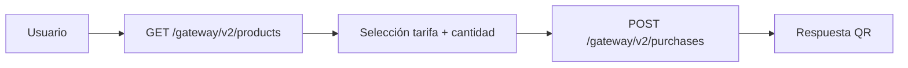

### Consola de Red de Recarga – Documentación Funcional

#### 1. Alcance

Este documento describe el flujo funcional y los endpoints que utiliza la **consola de Red de Recarga** del back‑office Juana, accesible desde el frontend Angular en:

- `https://sir-siva.Juana.co/back-office/recargar`

Se documentan:

- Flujo de autenticación y contexto.
- Entidades implicadas (usuario, sucursal/branch, recarga, tarjeta).
- Endpoints HTTP que consume el front para esta consola.
- **Ventas PAX QR** (recarga/venta de códigos QR vía API Gateway del backend).
- Secuencia típica de uso y reglas de negocio inferidas.

> Nota: los endpoints descritos existen en el entorno de ejecución; parte de ellos (`recharge-card`, `my-cards`, `base-search`, rutas del gateway) pueden no aparecer en este árbol de código o estar agrupados en otro módulo. La documentación se basa en cómo los consume el frontend Angular.

---

#### 2. Flujo de autenticación y contexto

La consola de Red de Recarga se apoya en autenticación **Laravel Sanctum** y en la obtención del contexto de usuario.

**Configuración Angular relevante (`urls-app.ts`):**

- `authentication.token = 'sanctum/token'`
- `authentication.user = 'user'`

**2.1. Login – Obtener token Sanctum**

- **Método**: `POST`
- **Path**: `/cashier-login`
- **URL completa**: `${ApiConstants.baseUrl}/cashier-login`
- **Headers**:
  - `Accept: application/json`
  - `Content-Type: application/json`
- **Body (ejemplo)**:

```json
{
  "phone_number": "usuario@ejemplo.com o número",
  "password": "********",
  "device_name": "pos_flutter"
}
```

- **Soporte Offline**: Existe un fallback implementado con SQLite local para permitir el inicio de sesión sin conexión utilizando los credenciales guardados de la sesión previa.

- **Respuesta esperada**:
  - String con el **token de acceso** (formato típico de Sanctum: `"id|token..."`).
- **Uso posterior**:
  - El frontend almacena este token y lo usa en el header:
    - `Authorization: Bearer <token>`

**2.2. Usuario actual – Contexto de sesión**

- **Método**: `GET`
- **Path**: `/user`
- **URL completa**: `${environment.uri}/user`
- **Headers**:
  - `Accept: application/json`
  - `Authorization: Bearer <token>`
- **Respuesta esperada (ejemplo de estructura):**

```json
{
  "id": 10,
  "name": "Operador Red Recarga",
  "email": "operador@Juana.co",
  "branch_id": 1,
  "roles": ["cajero", "operador_red"]
}
```

- **Uso en frontend**:
  - Se guarda en `localStorage['user']`.
  - Define:
    - Rol(es) y permisos visibles en el menú de back‑office.
    - `branch_id` (sucursal) que se utilizará para filtrar datos de recarga y saldo.

---

#### 3. Entidades y modelo conceptual

**3.1. Usuario de back‑office**

- Autenticado vía Sanctum.
- Asociado a:
  - Uno o varios **roles** (por ejemplo, cajero, administrador, operador de red).
  - Una **sucursal** (`branch_id`) desde la cual opera.
- Impacto:
  - Controla el acceso a `/back-office/recargar`.
  - Determina de qué sucursal se muestran recargas y saldo.

**3.2. Sucursal / Branch**

- Identificador principal: `id`.
- Atributos relevantes:
  - `nombre`.
  - `balance` (saldo de la sucursal / caja).
- El usuario autenticado opera generalmente sobre una sucursal.

**3.3. Tarjeta / MyCard**

- Representa una tarjeta o unidad de saldo asociada a una sucursal o a un perfil.
- Atributos típicos:
  - `id`.
  - `branch_id`.
  - `balance`.
  - `estado` (activa/bloqueada).
- La consola de Red de Recarga usa este recurso para obtener el **saldo de la sucursal**.

**3.4. Recarga**

- Entidad principal de la consola de Red de Recarga.
- Atributos inferidos:
  - `id`.
  - `card_id`: tarjeta/perfil recargado.
  - `branch_id`: sucursal donde se realiza la operación.
  - `amount`: valor de la recarga.
  - `payment_method_id`: medio de pago utilizado.
  - `created_at`, `updated_at`.
  - `created_by` / usuario que ejecutó la operación (deducido).
  - Posible `status` (ej.: pendiente, aplicada, anulada).

---

#### 4. Endpoints funcionales de la consola de Red de Recarga

Los endpoints se definen a partir de `environment.uri` (backend base) y de las claves en `urls-app.ts`:

- `recharge.api_resource = 'recharge-card'`
- `my_card.api_resource = 'my-cards'`
- `base.api_search = 'base-search'`

##### 4.1. Listar recargas – `GET /recharge-card`

- **Método**: `GET`
- **Path**: `/recharge-card`
- **URL completa**: `${environment.uri}/recharge-card`
- **Query params**:
  - `page` (opcional): número de página.
- **Headers**:
  - `Accept: application/json`
  - `Authorization: Bearer <token>`
- **Respuesta esperada (paginada, ejemplo):**

```json
{
  "data": [
    {
      "id": 1,
      "card_id": 123,
      "amount": 5000,
      "branch_id": 1,
      "payment_method_id": 2,
      "created_at": "2026-03-15T10:00:00Z"
    }
  ],
  "meta": {
    "current_page": 1,
    "last_page": 5,
    "per_page": 15,
    "total": 75
  },
  "translate_fillable": {
    "id": "ID",
    "card_id": "Tarjeta",
    "amount": "Valor",
    "created_at": "Fecha"
  }
}
```

- **Uso en frontend**:
  - `data`: filas de la tabla principal de recargas.
  - `translate_fillable`: cabeceras de columnas.
  - `meta`: paginación en la UI.

##### 4.2. Crear recarga – `POST /recharge-card`

- **Método**: `POST`
- **Path**: `/recharge-card`
- **URL completa**: `${environment.uri}/recharge-card`
- **Headers**:
  - `Accept: application/json`
  - `Content-Type: application/json`
  - `Authorization: Bearer <token>`
- **Body (ejemplo genérico):**

```json
{
  "card_id": 123,
  "amount": 5000,
  "branch_id": 1,
  "payment_method_id": 2,
  "description": "Recarga en ventanilla"
}
```

- **Validaciones de negocio esperadas**:
  - El usuario está autenticado y autorizado para operar sobre la `branch_id`.
  - `card_id` existe y pertenece a un estado válido (no bloqueada).
  - `amount > 0` y dentro de los límites configurados.
  - `payment_method_id` corresponde a un medio de pago habilitado.
- **Efectos esperados**:
  - Creación de un registro de recarga.
  - Actualización de balances internos (tarjeta / caja / contabilidad).
  - Registro de auditoría (usuario, fecha/hora, IP, etc.).

##### 4.3. Ver detalle de recarga – `GET /recharge-card/{id}`

- **Método**: `GET`
- **Path**: `/recharge-card/{id}`
- **Headers**:
  - `Accept: application/json`
  - `Authorization: Bearer <token>`
- **Respuesta esperada**:
  - Objeto recarga individual con los campos detallados.

##### 4.4. Actualizar recarga – `PUT /recharge-card/{id}`

- **Método**: `PUT`
- **Path**: `/recharge-card/{id}`
- **Headers**:
  - `Accept: application/json`
  - `Content-Type: application/json`
  - `Authorization: Bearer <token>`
- **Body (ejemplo):**

```json
{
  "id": 1,
  "amount": 6000
}
```

- **Reglas de negocio típicas**:
  - Solo se permiten cambios si la recarga no está consolidada/liquidada.
  - Cambios de `amount` deben recalcular los impactos en balances.

##### 4.5. Eliminar recarga – `DELETE /recharge-card/{id}`

- **Método**: `DELETE`
- **Path**: `/recharge-card/{id}`
- **Headers**:
  - `Accept: application/json`
  - `Authorization: Bearer <token>`
- **Comportamiento esperado**:
  - Marca la recarga como eliminada/anulada o la elimina físicamente.
  - Revierte o compensa sus efectos en los saldos asociados.

---

#### 5. Saldo de sucursal – `GET /my-cards`

**Configuración Angular:**

- `my_card.api_resource = 'my-cards'`

**5.1. Endpoint:**

- **Método**: `GET`
- **Path**: `/my-cards`
- **URL completa**: `${environment.uri}/my-cards`
- **Query params**:
  - `branch_id` (obligatorio): id de la sucursal.
- **Headers**:
  - `Accept: application/json`
  - `Authorization: Bearer <token>`
- **Respuesta esperada (ejemplo):**

```json
{
  "data": [
    {
      "id": 1,
      "branch_id": 1,
      "balance": 3500000
    }
  ]
}
```

- **Uso en frontend**:
  - Se toma `data[0].balance` y se muestra en la parte superior de la consola formateado como moneda (COP).
  - En Angular se usa `BranchId` desde `localStorage` para armar el parámetro `branch_id`.

---

#### 6. Búsqueda – `GET /base-search`

**Configuración Angular:**

- `base.api_search = 'base-search'`

**6.1. Endpoint:**

- **Método**: `GET`
- **Path**: `/base-search`
- **URL completa**: `${environment.uri}/base-search`
- **Query params**:
  - `page` (opcional): número de página.
  - `query` (opcional): término de búsqueda.
- **Headers**:
  - `Accept: application/json`
  - `Authorization: Bearer <token>`
- **Comportamiento esperado:**
  - Devuelve una lista paginada filtrada por el criterio de búsqueda.
  - La consola de recarga utiliza este endpoint para mostrar resultados filtrados en la tabla.

---

#### 7. Ventas PAX QR – `app-sale-qr` (recarga / venta de QR)

Esta pantalla no usa `recharge-card` sino el **API Gateway** del backend para listar **productos/tarifas** y registrar **compras** que devuelven datos para generar códigos QR (PAX QR).

##### 7.1. Ubicación en el frontend

| Concepto | Valor |
|----------|--------|
| **Ruta Angular** | `/back-office/recargar/venta-qr` |
| **Título en routing** | `Ventas PAX QR` |
| **Selector** | `app-sale-qr` |
| **Módulo** | `recharge` (`recharge-routing.module.ts`, `recharge.module.ts`) |
| **Componente** | `sale-qr/sale-qr.component.ts` |
| **Servicio HTTP** | `services/sale-qr.service.ts` |
| **Navegación desde consola** | Desde `/back-office/recargar`, acción tipo `QR` → `router.navigate(['/back-office/recargar/venta-qr'])` |

##### 7.2. Configuración de URLs (`urls-app.ts` → `gateway`)

- `gateway.api_index_product = 'gateway/v1/products'`
- `gateway.api_purchase_product = 'gateway/v1/purchases'`

Todas las peticiones van contra **`${environment.uri}`** (misma base que el resto de la API, actualmente apuntando a `http://35.209.80.61:8089/api`).

##### 7.3. Endpoints consumidos por `SaleQrService`

**7.3.1. Listar productos / tarifas para el desplegable**

- **Método**: `GET`
- **Path**: `/gateway/v2/products`
- **URL completa**: `${ApiConstants.baseUrl}/gateway/v2/products`
- **Query params**:
  - `page` (opcional): si se proporciona una página > 0, se añade a los parámetros de la solicitud.
- **Headers**:
  - `Accept: application/json`
  - `Authorization: Bearer <token>`
- **Uso en UI**:
  - El componente recibe `{ data }` y deduplica por `product_name`, quedándose con el registro de **mayor `id`** por nombre de producto.
  - Cada ítem expone al menos: `_id`, `product_name`, `value` (se muestra en el `<ng-select>` como “Valor | nombre”).

**7.3.2. Registrar venta / generación de QR**

- **Método**: `POST`
- **Path**: `/gateway/v2/purchases`
- **URL completa**: `${ApiConstants.baseUrl}/gateway/v2/purchases`
- **Headers**:
  - `Content-Type: application/json`
  - `Accept: application/json`
  - `Authorization: Bearer <token>`
- **Body**:

```json
{
  "product_id": "<id del producto seleccionado (_id del ítem en la lista)>"
}
```

- **Comportamiento en frontend**:
  - El usuario elige **tarifa** (`product`) y **cantidad de PAX** (`quantity` ≥ 1).
  - Se ejecutan **N peticiones secuenciales** (una por cada unidad), vía `rxjs` `range` + `concatMap`, con un `delay(200)` ms entre respuestas para no saturar.
  - De cada respuesta se toma **`response.data`** y se acumula en `qrsGenerated`.
- **Campos usados en la vista previa / PDF** (por cada elemento en `data`):
  - `qr_code`: string que alimenta el componente `ngx-qrcode`.
  - `transaction_id`: texto mostrado bajo cada QR y en la leyenda “QR #n”.
- **Generación de PDF**:
  - Ocurre **solo en el navegador** (`jspdf` + `html2canvas` sobre los elementos `#qr-code-{i}`); no llama a endpoints adicionales.

##### 7.4. Endpoint auxiliar: datos de la compañía (cabecera contextual)

Para enriquecer el contexto (nombre y documento de la empresa asociada a la sesión), el componente llama a **`ListCompanyService.getCompanyList`**, que usa:

- **Método**: `GET`
- **Path**: `/company-list` (según `environment.company.api_list`)
- **Header especial**:
  - `x-filter-model`: JSON con filtro, p. ej. `{"type":"DESC","singleQuery":["id","=", "<CompanyId desde localStorage>"]}`
- **Uso**:
  - Rellena `companyName` y `companyDocumentNumber` en memoria; el PDF de ejemplo incluye textos fijos de una empresa (Valledupar); si se unifica con datos dinámicos, habría que revisar el template del PDF en el propio componente.

##### 7.5. Mapa conceptual del flujo QR (venta)



##### 7.6. Relación con “reportes” de QR

En el menú de **Reportes** del back‑office existe una entrada relacionada con impresión/listado de QR PAX (ruta tipo `reportes/qr-code-impreso` según el sidebar). Esa pantalla es **distinta** de la venta masiva de QR de esta sección: allí se consumen endpoints bajo el namespace de reportes (p. ej. `qr-code-impress` en `urls-app.reports`), no el flujo `gateway/v1/purchases` documentado aquí.

---

#### 8. Flujo de uso típico (secuencia resumida)

1. Usuario accede a `/back-office/recargar`.
2. Si no está autenticado:
   - Se le redirige a login y se realiza `POST /sanctum/token`.
3. Con token válido:
   - Se llama a `GET /user` para obtener contexto (`branch_id`, roles).
   - El front determina qué opciones de menú mostrar según roles.
4. Al entrar en la consola de Red de Recarga:
   - Se obtiene el saldo de la sucursal con `GET /my-cards?branch_id=<BranchId>`.
   - Se lista el histórico de recargas con `GET /recharge-card?page=1`.
5. El usuario puede:
   - Crear nuevas recargas (`POST /recharge-card`).
   - Ver, editar y eliminar recargas existentes (`GET/PUT/DELETE /recharge-card/{id}`).
   - Buscar recargas mediante `GET /base-search?page=&query=`.
6. Si navega a **Ventas PAX QR** (`/back-office/recargar/venta-qr`):
   - Carga catálogo con `GET /gateway/v1/products`.
   - Genera tantos QR como indique la cantidad con `POST /gateway/v1/purchases` (una petición por unidad).
   - Opcionalmente exporta un PDF generado en el cliente.

Este documento sirve como referencia rápida para desarrolladores y analistas que necesiten entender y trazar el comportamiento de la **consola de Red de Recarga** y las **ventas PAX QR** desde el frontend hasta los endpoints de backend que consume.

